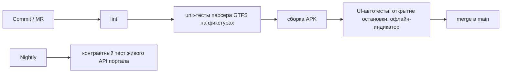

# Задача 20: Приложение «Расписание транспорта»

**Студент:** Лупач Д.А.

Открытые данные + офлайн-режим. Спланируйте Sprint Goal, препятствия (impediments) и работу SM. Kanban с блокерами по данным API. XP: Spike/простое решение (Simple Design), Continuous Integration, User Stories.

## Решение

## Scrum 

### Роли
+ **Product Owner(Владелец продукта)** - Владеет Product Backlog, приоритизирует фичи, общается с заказчиком (городской департамент транспорта)

+ **Scrum Master(Скрам-мастер)** -
    - Организует ежедневные стендапы, планирование спринта, обзоры итогов и ретроспективы
    - Устраняет препятствия: ищет и убирает всё, что тормозит команду: технические проблемы, бюрократические барьеры, внешние вмешательства

+ **Developers(Разработчики)** -
    * Developer 1(Мобильный клиент / UI): front(Экраны, навигация, офлайн-индикатор, отображение кэша)
    * Developer 2(данные/API): Отвечает за получение расписания из внешнего открытого источника,  Обеспечивает, чтобы при недоступном или медленном внешнем сервисе приложение показывало сохранённые данные, а не падало.
    * Developer 3(офлайн и хранение): Локальная БД, синхронизация, TTL расписаний

+ **AQA/QA(Тестировщик)** -
    - Тест-кейсы под офлайн-режим
    - Проверка критериев приёмки PO на Sprint Review
    - UI-автотесты ключевых сценариев: открытие остановки, офлайн-индикатор, избранное

### Артефакты

**Product Backlog** (фрагмент, приоритизирован PO):

| # | Элемент | Оценка (SP) | Приоритет |
|---|---------|-------------|-----------|
| 1 | Загрузка GTFS-фида с портала (парсинг расписания) | 8 | Высокий |
| 2 | Экран «Ближайшие остановки» по геолокации | 5 | Высокий |
| 3 | Офлайн-кэш расписания (SQLite) | 8 | Высокйи |
| 4 | Поиск остановки по названию | 3 | Средний |
| 5 | Push-уведомления об изменениях | 5 | Средний |
| 6 | Тёмная тема | 2 | Низкий |

**Sprint Backlog** (Sprint 1, цель — «Пользователь видит актуальное расписание ближайшей остановки онлайн»):

| Элемент | SP | Задача |
|---------|-----|--------|
| #1 Загрузка GTFS | 8 | Парсер + маппинг в модель |
| #2 Ближайшие остановки | 5 | Геолокация + список |
| #3 Офлайн-кэш (базовая версия) | 5 | Сохранение последнего фида |

**Sprint Goal:** «К концу спринта пользователь открывает приложение, видит ближайшую остановку и расписание на сегодня — даже если API ответил с задержкой».

### 2.3. События спринта (2 недели)

| Событие | Когда | Что делаем (конкретно) |
|---------|-------|------------------------|
| **Sprint Planning** | День 1, 2 ч | PO показывает топ бэклога, команда оценивает в SP (покер), формирует Sprint Goal |
| **Daily Scrum** | Каждый день, 15 мин | Dev1: «вчера парсил GTFS, сегодня — обработка ошибок API, блокеров нет». Dev2: «жду макет экрана от дизайнера — блокер» → SM фиксирует |
| **Sprint Review** | День 14 | Демо: приложение показывает остановку «Площадь Ленина» и расписание автобуса №5. PO принимает инкремент |
| **Sprint Retrospective** | День 14, 1 ч | Что хорошо: парсер сделали быстро. Что улучшить: API часто падает — нужен fallback. Action item: добавить retry-логику в Sprint 2 |

### 2.4. Поток работы одного спринта

### 2.5. Работа Scrum Master и препятствия (impediments)

| Препятствие | Дата | Действие SM | Статус |
|---------|-------|------------------------|---------|
| API портала отдаёт 503 в тестовой среде | День 3 | Написал в поддержку портала, договорился о тестовом ключе | Решено (день 5) |
| Нет макета экрана «Ближайшие остановки» | День 2 | Связал Разрботчика с дизайнером, макет получен| Решено (день 3)|
| Неясен формат GTFS для трамваев | День 4 | Организовал встречу PO + заказчик | Решено (день 6) |

## 2. Kanban

Спринтовый Scrum-бэклог мы дополнительно ведём на Kanban-доске: каждый элемент Sprint Backlog (#1, #2, #3) разбит на небольшие карточки `TR-1 … TR-10` (по 1–3 SP, сумма = 18 SP). Доска помогает видеть **поток** между ежедневными стендапами: где карточки копятся, кто чего ждёт, что заблокировано.

Полное описание доски (колонки, WIP-лимиты, легенда, срез и разбор) — в файле **[board.md](board.md)**. Коротко:

- **Колонки:** `Sprint Backlog → In Progress (WIP 3) → Code Review (WIP 2) → Testing (WIP 2) → Done`.
- **WIP-лимиты** ограничивают число параллельных задач: команда из трёх разработчиков и одного QA не должна «размазываться» по десяти карточкам сразу.
- **Блокеры по данным API** (503/таймауты портала, пустые поля в фиде, устаревший `feed_end_date`, неясный формат) помечаются флажком 🚫 прямо на карточке. Заблокированная карточка **остаётся в своей колонке и занимает слот WIP**, чтобы проблема была видна, а не пряталась в отдельной колонке.
- **Срез на день 8 спринта:** 6 из 18 SP в Done; колонка In Progress заполнена на 3/3, одна из трёх карточек — TR-10 «GTFS трамваев» — заблокирована данными портала; Testing при этом наполовину пуст. Это и есть главное узкое место потока (разбор — в `board.md`).
- **Реакция:** SM эскалирует блокер владельцу данных, PO решает вопрос о переносе трамваев в Sprint 2 (Sprint Goal про автобус №5 от этого не страдает).

---

## 3. Extreme Programming (XP)

Из практик XP разобраны четыре: Spike, Simple Design, Continuous Integration, User Stories.

### 3.1. Spike (исследовательская задача)

**Что это.** Короткая задача с жёстким временным ограничением (timebox), результат которой — не рабочая фича, а *знание* для принятия решения.

| Spike | Timebox | Вопрос | Результат |
|-------|---------|--------|-----------|
| SP-1 «Формат GTFS трамваев» | 4 ч, день 4 | Чем трамвайный фид отличается от автобусного? Есть ли `frequencies.txt`? | Выяснили, что трамваи частично описаны через `frequencies.txt`, а не через точные `stop_times`. Решение зафиксировано в мини-ADR, парсеру нужна отдельная ветка |
| SP-2 «Размер фида и хранение офлайн» | 3 ч, день 2 | Сколько весит фид и сколько хранить в SQLite? | Zip ≈ 40 МБ; решили хранить только `stops`, `routes`, `trips`, `stop_times` и только на ближайшие 7 дней |

**Зачем.** Без Spike команда оценила бы «GTFS трамваев» «на глаз» и промахнулась бы в SP; либо разработчик неделю писал бы парсер, а потом выяснил, что модель данных не подходит. Spike ограничивает потери четырьмя часами.

### 3.2. Simple Design (простое решение)

**Что это.** Делаем самое простое, что удовлетворяет текущим требованиям; не закладываем «на будущее».

- **Поиск ближайших остановок (TR-5):** простой линейный перебор по всем остановкам с формулой гаверсинуса, без пространственного индекса (R-tree/геохеши). В городе ≈ 3 000 остановок, перебор занимает единицы миллисекунд. Индекс добавим, только если замеры покажут проблему.
- **Офлайн-кэш (TR-7):** сохраняем «последний успешно загруженный фид» целиком одной транзакцией. Инкрементальная синхронизация (дельты) и конфликт-резолюшн — не в Sprint 1.
- **Push-уведомления (#5) и тёмная тема (#6)** не затрагиваем: ни архитектурных «хуков», ни абстракций под них в коде нет.
- **Код:** один репозиторий `TransportRepository` с двумя источниками (API и SQLite) вместо слоя «универсальных провайдеров данных».

**Эффект.** Меньше кода → быстрее ревью и проходит WIP-лимит; рефакторинг дешевле, когда требования появятся.

**Риск без практики.** Over-engineering: потратили бы 2–3 дня на синхронизацию, которая не нужна для Sprint Goal.

### 3.3. Continuous Integration (непрерывная интеграция)

**Что это.** Все разработчики часто (минимум раз в день) сливают маленькие изменения в основную ветку; каждое слияние автоматически собирается и тестируется.

- **Фикстуры вместо живого API.** Unit-тесты парсера идут на сохранённых мини-фидах: нормальный автобусный, трамвайный с пустыми `arrival_time` (кейс TR-10), фид с битой кодировкой и фид с истёкшим `feed_end_date`. CI поэтому **не падает из-за 503 портала**.
- **Контрактный тест живого API — ночью, отдельным джобом.** Если портал изменил формат, мы узнаём об этом утром, а не на Sprint Review. Падение этого джоба автоматически создаёт карточку-блокер на доске.
- **Правила:** MR живёт не дольше дня; «красный» `main` чинится в первую очередь (команда не берёт новые карточки, пока не зелёный); в Code Review карточка попадает только с зелёным пайплайном.

**Риск без практики.** Интеграция «в конце спринта»: парсер Dev2, БД Dev3 и UI Dev1 не стыкуются; регрессии в офлайн-режиме ловятся только на демо.

### 3.4. User Stories (пользовательские истории)

**Что это.** Требование, записанное с позиции пользователя: «Как <роль>, я хочу <действие>, чтобы <ценность>», с критериями приёмки.

**Как у нас (по элементам Sprint 1).**

| Элемент | История | Критерии приёмки (Given / When / Then) |
|---------|---------|----------------------------------------|
| #1 | Как пассажир, я хочу видеть актуальное расписание автобуса №5, чтобы не опоздать на остановке «Площадь Ленина» | **Given** фид загружен, **When** я открываю остановку, **Then** вижу ближайшие 5 рейсов №5 на сегодня по текущему времени |
| #2 | Как пассажир, я хочу видеть ближайшие остановки рядом со мной, чтобы быстро выбрать, куда идти | **Given** выдано разрешение на геолокацию, **When** открываю главный экран, **Then** вижу список остановок в радиусе 500 м, отсортированный по расстоянию |
| #3 | Как пассажир в метро/на окраине без сети, я хочу видеть сохранённое расписание, чтобы планировать поездку офлайн | **Given** фид раньше уже загружен, **When** нет сети или API вернул 503, **Then** показывается кэш и индикатор «Офлайн, данные от \<дата\>» |

**Как используются.** Истории проверяют INVEST (Independent, Negotiable, Valuable, Estimable, Small, Testable); оцениваются покером на Planning; критерии приёмки превращаются в тест-кейсы QA и UI-автотесты, а PO сверяет с ними инкремент на Sprint Review. Каждая карточка `TR-*` на доске ссылается на историю (#1/#2/#3).

**Риск без практики.** Разработчики делают «техническую» загрузку фида без понимания, что пользователю нужны именно *ближайшие рейсы на сегодня*; нет общего критерия «готово».

---

## Файлы решения

| Файл | Содержание |
|------|------------|
| `README.md` | Постановка, Scrum, краткое описание Kanban, практики XP |
| `board.md` | Колонки и WIP, легенда карточек, срез доски на день 8, разбор узких мест и блокеров по данным API |
