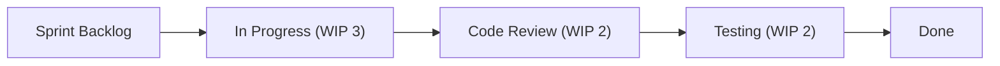

# Kanban-доска: «Расписание транспорта» (Sprint 1)


Доска отражает Sprint Backlog из `README.md`: элементы #1, #2, #3 (18 SP) разбиты на карточки `TR-1 … TR-10`.

## 1. Колонки доски и WIP-лимиты

| Колонка | WIP-лимит | Правило входа (pull) | Правило выхода |
|---------|-----------|----------------------|----------------|
| **Sprint Backlog** | — | Карточка выбрана на Sprint Planning | Разработчик берёт карточку, когда в In Progress есть свободный слот |
| **In Progress** | 3 | Есть свободный слот; карточка понятна (есть критерии приёмки) | Код написан, unit-тесты зелёные, открыт MR |
| **Code Review** | 2 | Зелёный пайплайн CI | Минимум 1 approve от другого разработчика |
| **Testing** | 2 | MR влит в `main`, сборка доступна QA | Критерии приёмки (Given/When/Then) проверены QA |
| **Done** | — | Выполнен Definition of Done: код в `main`, тесты, проверка QA | — |

**Почему такие лимиты.** В команде три разработчика, поэтому In Progress = 3 (по одной задаче на человека, без многозадачности). Review и Testing = 2: один QA и ревью не должны копить очередь — «остановить начинать, начать заканчивать».

**Блокеры не выносим в отдельную колонку.** Заблокированная карточка остаётся там, где стоит, и **продолжает занимать слот WIP** — это сознательное правило, чтобы блокер был виден и давил на систему.



## 2. Легенда карточек

| Обозначение | Значение |
|-------------|----------|
| `TR-N` | Номер карточки (Transport) |
| `(2)` | Оценка в story points |
| `#1 / #2 / #3` | Элемент Product/Sprint Backlog, к которому относится карточка |
| `D1 / D2 / D3 / QA` | Исполнитель (Developer 1 — UI, Developer 2 — данные/API, Developer 3 — офлайн и хранение, QA) |
| 🚫 | Карточка **заблокирована** (причина — в строке `Блокер`) |
| 🟡 | Карточка стоит в колонке дольше 2 дней (риск) |

**Пример карточки:**

```
┌──────────────────────────────┐
│ TR-10 (2) #1   D2   🚫       │
│ GTFS трамваев: парсинг       │
│ Блокер: пустые arrival_time  │
│ с дня 7, ждём владельца      │
└──────────────────────────────┘
```

**Карточки спринта:**

| Карточка | SP | Элемент | Название |
|----------|----|---------|----------|
| TR-1 | 2 | #1 | HTTP-клиент загрузки GTFS-фида с портала |
| TR-2 | 2 | #1 | Парсер `stops.txt` / `routes.txt` |
| TR-3 | 2 | #1 | Парсер `trips.txt` / `stop_times.txt` (автобусы) |
| TR-10 | 2 | #1 | **GTFS трамваев**: парсинг (`frequencies.txt`, пустые времена) |
| TR-4 | 2 | #2 | Запрос разрешения и получение геолокации |
| TR-5 | 3 | #2 | Список ближайших остановок (гаверсинус, радиус 500 м) |
| TR-8 | 2 | #2 | Экран остановки: ближайшие рейсы + офлайн-индикатор |
| TR-6 | 4 | #3 | Схема SQLite (stops, routes, trips, stop_times) |
| TR-7 | 2 | #3 | Сохранение последнего фида в SQLite |
| TR-9 | 1 | #3 | Таймаут + fallback на кэш при 503/таймауте |

Сумма: 8 (#1) + 7 (#2) + 7 (#3) = **22 SP**.

## 3. Срез доски на день 8 спринта

```
┌───────────────┬──────────────────┬────────────────┬───────────────┬──────────────┐
│ Sprint Backlog│  In Progress 3/3 │ Code Review 1/2│  Testing 1/2  │     Done     │
├───────────────┼──────────────────┼────────────────┼───────────────┼──────────────┤
│ TR-8 (2) #2   │ TR-5 (3) #2  D1  │ TR-3 (2) #1 D2 │ TR-4 (2) #2   │ TR-1 (2) #1  │
│ Офлайн-       │ Список ближайших │ Парсер trips / │ QA            │ HTTP-клиент  │
│ индикатор     │ остановок        │ stop_times     │ Геолокация    │              │
│               │                  │                │               │ TR-2 (2) #1  │
│ TR-9 (1) #3   │ TR-7 (2) #3  D3  │                │               │ Парсер stops │
│ Fallback на   │ Сохранение       │                │               │              │
│ кэш при 503   │ фида в SQLite    │                │               │ TR-6 (2) #3  │
│               │                  │                │               │ Схема SQLite │
└───────────────┴──────────────────┴────────────────┴───────────────┴──────────────┘
   2 карточки        3 карточки        1 карточка      1 карточка     3 карточки
   2 SP              6 SP              2 SP            2 SP           6 SP
```

**Итого:** Done — 6 SP из 22 (33 %), в работе (In Progress + Review + Testing) — 10 SP, не начато — 2 SP.

**Состояние по людям:**

- **D1** — TR-5 (идёт нормально).
- **D2** — TR-3 в ревью, **TR-10 заблокирована**: фактически D2 ждёт чужих данных.
- **D3** — TR-7 (идёт нормально).
- **QA** — тестирует TR-4, свободен на 1 слот.

## 4. Разбор узких мест и потока

### 4.1. Заполненность колонок

| Колонка | Занято / лимит | Заполнение | Оценка |
|---------|----------------|------------|--------|
| Sprint Backlog | 2 / — | — | Очередь коротка, всё важное уже в работе |
| **In Progress** | **3 / 3** | **100 %** | 🔴 Полностью заполнена, новые карточки не берутся |
| Code Review | 1 / 2 | 50 % | 🟢 Есть запас |
| Testing | 1 / 2 | 50 % | 🟢 QA недогружен |
| Done | 3 / — | — | 6 SP из 18 |

### 4.2. Узкое место: In Progress (3/3)

**Что видим.** Колонка забита до лимита, а справа от неё (Review, Testing) есть свободные слоты — то есть **работа не «доходит» до QA**. Классический признак узкого места: справа пусто, слева очередь.

**Почему так.** Один из трёх слотов занимает **TR-10**, которая не может двигаться из-за данных. Реально работают только две карточки (TR-5, TR-7), а лимит в 3 не позволяет D2 взять `TR-9` или `TR-8`: слот занят блокером.

**Эффект на метрики:**

- Пропускная способность: за 8 дней закрыто 6 SP (≈ 0,75 SP/день). Для 18 SP к концу спринта нужно ≈ 2 SP/день — **есть риск не закрыть спринт целиком**.
- Эффективная загрузка WIP: 2 рабочих карточки из 3 слотов = 67 %.
- Простой QA: Testing заполнен на 50 %.

**Решение, которое принимаем (без отмены WIP-лимита):**

1. D2 (swarming) отдаёт ревью TR-3 по возможности быстро и вместо ожидания помогает D1 с TR-5/TR-8: парное программирование освобождает слот быстрее.
2. По правилу эскалации (раздел 5.3) **PO на Daily день 9 решает перенести TR-10 в Sprint 2**; слот освобождается, D2 берёт `TR-9` (fallback на кэш) — она ближе всего к Sprint Goal.
3. Лимит WIP **не повышаем**: это скрыло бы проблему, а не решило её.

### 4.3. Блокер: TR-10 «GTFS трамваев»

| Поле | Значение |
|------|----------|
| Карточка | TR-10 (2 SP), элемент #1, исполнитель D2 |
| Колонка | In Progress, 🚫 |
| Заблокирована с | Дня 7 (в колонке с дня 6) |
| Причина | Трамвайный фид на портале: в `stop_times.txt` у многих рейсов пустые `arrival_time`/`departure_time`; часть рейсов описана через `frequencies.txt` без точных времён |
| Что уже сделано | Spike SP-1 (день 4), встреча PO + заказчик (день 6): формат согласован. Но **данные на портале не соответствуют согласованному формату** |
| Ожидаем | Ответ владельца набора данных на портале (запрос отправил SM в день 7) |
| Влияние на Sprint Goal | **Низкое**: цель про «ближайшую остановку и расписание на сегодня» демонстрируется на автобусе №5; трамваи в демо не обязательны |
| Если ответа нет к дню 9 | PO переносит TR-10 в Sprint 2; в Sprint 1 остаётся поддержка автобусного фида |

## 5. Специфика задачи: блокеры по данным API

В продукте, построенном на открытых данных, значительная часть риска лежит *вне* команды. Поэтому на доске есть отдельная классификация блокеров, помеченных 🔌.

### 5.1. Типы блокеров по данным/API

| Тип | Пример из проекта | Кто разбирает | Обходной путь |
|-----|-------------------|---------------|---------------|
| Недоступность API | Портал отдаёт 503 в тестовой среде (день 3) | SM → поддержка портала | Тестовый ключ (решено в день 5); локальные фикстуры в CI |
| Неполные/пустые данные | Пустые `arrival_time` у трамваев (**TR-10**) | SM → владелец набора данных, PO | Вычислять время по `frequencies.txt`; либо перенос в Sprint 2 |
| Неясный/изменившийся формат | Формат GTFS для трамваев (день 4) | PO + заказчик | Spike SP-1, фиксация решения |
| Устаревший фид | `feed_end_date` в прошлом | Dev2 | Показать пользователю дату актуальности, не падать |
| Лимиты / ключи доступа | Ограничение числа запросов к порталу | SM | Кэширование, нечастая загрузка (раз в сутки) |

### 5.2. Правила работы с блокерами

1. Любой, кто обнаружил блокер данных, **в тот же день** ставит 🚫 на карточку и пишет причину и дату.
2. Блокер озвучивается на ближайшем Daily Scrum; SM заводит его в таблицу препятствий (`README.md`, п. 1.5).
3. Заблокированная карточка **остаётся в своей колонке и занимает слот WIP**.
4. Разработчик не простаивает: он помогает коллеге (swarming) или берёт задачу, не зависящую от данных (при наличии слота).
5. Ночной контрактный тест API в CI автоматически создаёт карточку-блокер, если формат или доступность портала изменились.